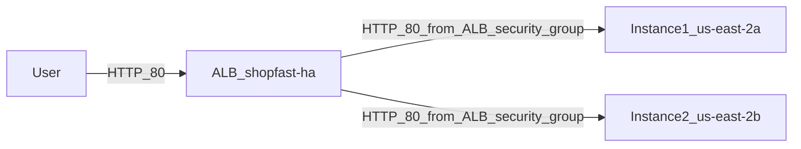
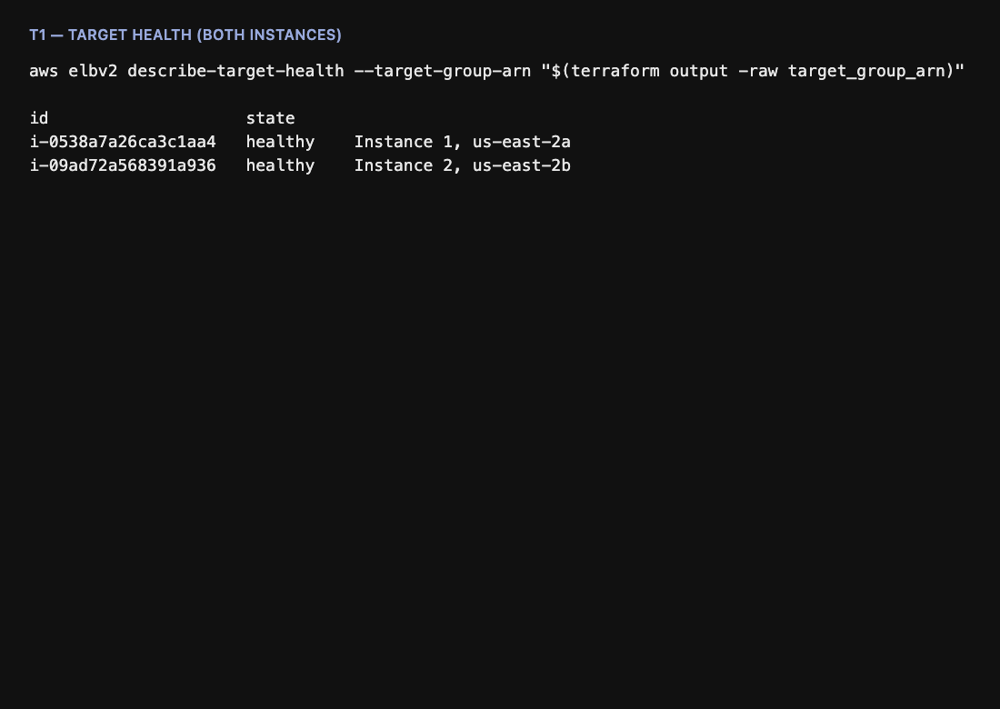
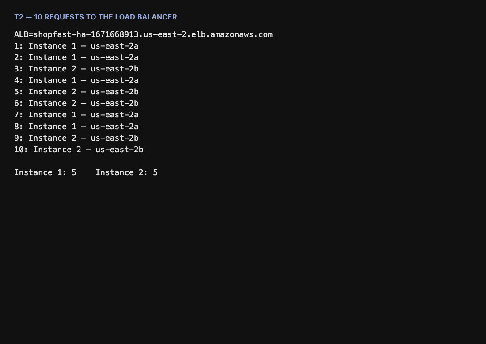
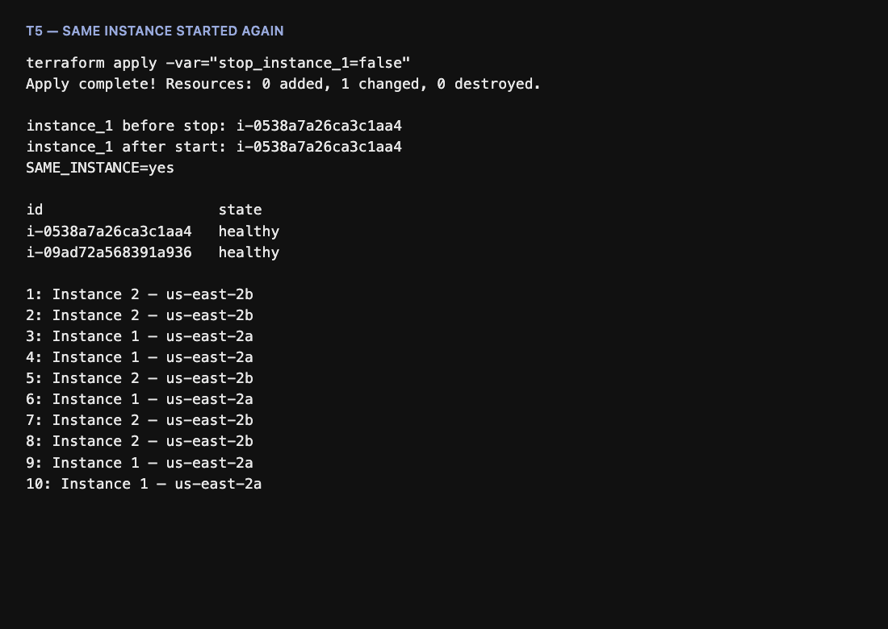
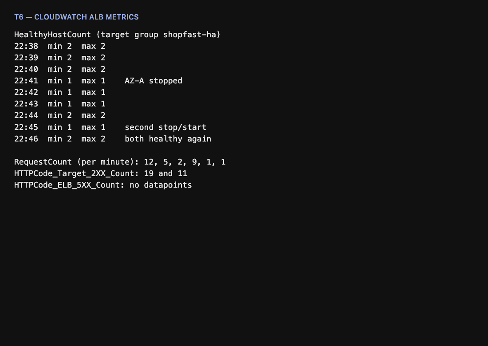

# High-Availability Web Service with Load Balancing

**Name:** [Your Name]  
**Student ID:** [Student ID]  
**Option:** A — AWS Application Load Balancer

ShopFast serves customers through one Application Load Balancer and two EC2 instances in two Availability Zones. Terraform in this folder is the source of the design. The load balancer is the only public entry point. Each instance answers with its own name and Availability Zone, and exposes `GET /health`.

The stack is running in `us-east-2` until you destroy it. An Application Load Balancer is billed by the hour. After you have any extra console screenshots you want, run `terraform destroy` from this folder.

## Problem 1 — Architecture



| Component | Role in this design |
| --- | --- |
| User | Sends HTTP to the load balancer DNS name. |
| Application Load Balancer | Only public entry point. Listens on port 80 and forwards to the target group. Nodes sit in both public subnets. |
| Target group `shopfast-ha` | Registers both instances and actively polls `/health`. Unhealthy or stopped targets leave rotation. |
| Instance 1 | Web server in `us-east-2a`. Page says `Instance 1 – us-east-2a`. |
| Instance 2 | Web server in `us-east-2b`. Page says `Instance 2 – us-east-2b`. |
| Security groups | The load balancer accepts internet traffic on port 80. Instances accept port 80 only from the load balancer security group. |

### VPC, subnets, Availability Zones, security groups

| Resource | Value |
| --- | --- |
| Region | `us-east-2` |
| VPC | `10.0.0.0/16` (`shopfast-ha`) |
| Public subnet, instance 1 | `10.0.1.0/24` in `us-east-2a` |
| Public subnet, instance 2 | `10.0.2.0/24` in `us-east-2b` |
| Internet gateway | Attached to the VPC. Public route table sends `0.0.0.0/0` to it. |
| `shopfast-ha-alb` | Inbound TCP 80 from `0.0.0.0/0`. Outbound to the instances. |
| `shopfast-ha-app` | Inbound TCP 80 from `shopfast-ha-alb` only. Outbound so the instances can install Nginx. No SSH. |
| Instances | `t2.micro`, Ubuntu 24.04. A public IP exists so `apt` works without a NAT gateway. Port 80 on that IP does not answer. |

NAT was skipped because a NAT gateway is a paid resource and is not required for this lab. The instance security group is what keeps users off the instances.

## Problem 2 and 3 — How to reproduce

Requirements: Terraform `>= 1.16.4`, the AWS CLI, and credentials that can create VPC, EC2, and ELB resources in `us-east-2`. No keys are stored in this repo.

```bash
cd terraform/assignment
terraform init
terraform plan
terraform apply
```

When both targets are healthy:

```bash
terraform output
curl -sS "http://$(terraform output -raw alb_dns_name)/health"
# healthy

for i in $(seq 1 10); do
  curl -sS "http://$(terraform output -raw alb_dns_name)/" | sed -n 's/.*<h1>\(.*\)<\/h1>.*/\1/p'
done
```

Open the same URL in a browser and refresh. The heading changes between the two instances.

Direct instance access must fail. This timed out (`curl` exit 28) against both public IPs while the load balancer answered:

```bash
curl -m 5 "http://<instance_public_ip>/"
```

### Failover and recovery

Stop the `us-east-2a` instance:

```bash
terraform apply -var="stop_instance_1=true"
```

Wait until that target is out of rotation, then send requests again. Start the same instance:

```bash
terraform apply -var="stop_instance_1=false"
```

`aws_ec2_instance_state` is the only switch. There is no SSH and no separate script.

### Destroy

```bash
cd terraform/assignment
terraform destroy
```

## Problem 4 — Health checks

Configured on `aws_lb_target_group.app`:

| Setting | Value | Why |
| --- | --- | --- |
| Path | `/health` | A dedicated check. It stays valid when the HTML page changes. Nginx returns 200 and `healthy` only while it is running. |
| Protocol and port | HTTP on the traffic port (80) | The same path users use, so a failure of the web server is the failure the check sees. |
| Success code | `200` | Anything else, including a refused connection, fails the check. |
| Interval | 10 seconds | Short enough to see failover in a lab. AWS allows 5 to 300 seconds. Ten seconds avoids probing on every possible tick. |
| Timeout | 5 seconds | Must be shorter than the interval. A healthy Nginx responds in milliseconds, so five seconds is a failed instance, not a slow page. |
| Healthy threshold | 2 | Two successes in a row before the instance receives traffic again. One lucky response does not put a flapping server back. |
| Unhealthy threshold | 2 | Two failures, about 20 seconds, before removal. One dropped probe does not eject the instance. The failover test waits until the target has left rotation, so those 20 seconds are not customer traffic. |

### Active and passive checks

An **active** health check is the load balancer opening its own connection on a timer and deciding from the response. A **passive** health check watches real customer traffic. Timeouts and failed responses, such as open-source NGINX `max_fails` and `fail_timeout`, eject a backend without a separate probe.

This Application Load Balancer uses **active** checks only. The target group polls `/health`. It does not eject an instance because customers saw errors. A stopped instance is reported as `unused` with reason `Target.InvalidState` and description `Target is in the stopped state`, because the load balancer cannot open a probe to a machine that is powered off. That state is out of rotation, same as `unhealthy`. An instance that stays up while Nginx is down would show `unhealthy`.

## Problem 5 — Tests

Load balancer: `shopfast-ha-1671668913.us-east-2.elb.amazonaws.com`

| Instance | Availability Zone | Instance id after the final recovery |
| --- | --- | --- |
| Instance 1 | us-east-2a | `i-0538a7a26ca3c1aa4` |
| Instance 2 | us-east-2b | `i-09ad72a568391a936` |

### T1 — Health status

Both targets healthy, read with `aws elbv2 describe-target-health`.



### T2 — Load distribution

Ten requests in a row. Five came from Instance 1 and five from Instance 2.

```text
1: Instance 1 – us-east-2a
2: Instance 1 – us-east-2a
3: Instance 2 – us-east-2b
4: Instance 1 – us-east-2a
5: Instance 2 – us-east-2b
6: Instance 2 – us-east-2b
7: Instance 1 – us-east-2a
8: Instance 1 – us-east-2a
9: Instance 2 – us-east-2b
10: Instance 2 – us-east-2b
```



### T3 — Browser

Refreshing the load balancer URL changes the page.


### T4 — AZ failure

`terraform apply -var="stop_instance_1=true"` stopped Instance 1. The target group then showed:

```text
i-0538a7a26ca3c1aa4  unused  Target.InvalidState  Target is in the stopped state
i-09ad72a568391a936  healthy
```

The next ten requests all returned `Instance 2 – us-east-2b`. None failed. The browser showed only Instance 2.


### T5 — Recovery

`terraform apply -var="stop_instance_1=false"` started the same instance. Terraform reported `0 added, 1 changed, 0 destroyed`. The instance id stayed `i-0538a7a26ca3c1aa4`. After two successful checks the target was healthy again, and ten new requests were split across both zones (five and five).



### T6 — Monitoring

CloudWatch `AWS/ApplicationELB` on this load balancer:

- `HealthyHostCount` sat at 2, dropped to 1 while `us-east-2a` was stopped, and returned to 2 after the start.
- `RequestCount` was non-zero through the tests (minute totals included 12, 9, and 5).
- `HTTPCode_Target_2XX_Count` recorded successful target responses (19 and 11 in the five-minute buckets).
- `HTTPCode_ELB_5XX_Count` had no datapoints. The load balancer did not serve errors while one zone was down.



## Problem 6 — Reflection

### 1. Application Load Balancer compared with NGINX

An Application Load Balancer is a regional AWS service. Placing it in two subnets makes AWS run the balancer nodes, the health checks, a stable DNS name, and cross-zone distribution. I do not patch that balancer or invent a virtual IP for it. The limit is cost and lock-in. The ALB is billed for every hour it exists, the health-check knobs are the ones AWS exposes, and the whole design lives in one region and one VPC. Open-source NGINX on my own computer costs nothing and can run any check I write, which is why it fits a machine with no cloud account. I would have to operate that NGINX myself, isolate two simulated networks, and add a second NGINX with keepalived or DNS failover so the balancer is more than one machine. NGINX open source watches failed customer requests through `max_fails`. It does not poll a `/health` URL on a timer unless another tool does that work. The target group in this lab does poll on a timer.

### 2. If the load balancer itself failed

If this load balancer stopped accepting traffic, customers would get nothing even while both web servers were healthy. The instance security group allows port 80 only from the load balancer, so there is no second door. Inside the region, AWS already spreads the ALB across the two subnets attached here. Losing `us-east-2a` removes one set of balancer nodes and one instance, and the DNS name still reaches `us-east-2b`. That failure is different from a single NGINX process on one VM. A failure of the whole ALB, or of the whole region, needs another layer. Production systems publish the balancer behind Amazon Route 53 health checks with a second region as the failover target, or they put AWS Global Accelerator in front of a load balancer in more than one region. When the check against the primary balancer fails, DNS or the accelerator sends customers to the other region. This lab has one region, so the balancer is still a regional dependency even though it is more than one virtual machine.

### 3. A problem during this assignment

The first recovery did not start the stopped server. Terraform destroyed it and created a new one. Stopping an EC2 instance releases its public IP, and the provider refreshed `associate_public_ip_address` from true to false. That setting forces a new instance, so the target-group attachment was replaced too. The page came back on a new instance id, which is a rebuild. I told Terraform to ignore later changes to `associate_public_ip_address`. The instance still asks for a public IP at launch, and a stop no longer looks like a request to rebuild it. I stopped `i-0538a7a26ca3c1aa4` again and started it with `stop_instance_1` set back to false. Terraform reported one change in place, the instance id stayed the same, the target became healthy on its own, and the next ten requests were split across both Availability Zones.
